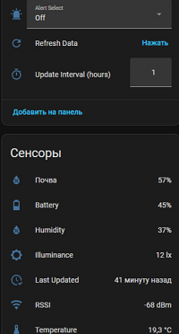

[🇷🇺 Русская версия](README.ru.md)
# 🌱 MCLH-09 Plant Sensor for Home Assistant

A custom integration for Home Assistant that connects directly to **MCLH-09** Bluetooth plant sensors without the need for intermediate MQTT gateways. All communication goes through your Home Assistant server's native Bluetooth adapter.

## ✨ Features

*   **Direct Connection:** Works via the built-in Bluetooth adapter (hci0) using the `bleak` library.
*   **Auto-Discovery:** Home Assistant automatically finds sensors in range.
*   **Sensors:** Temperature, Air Humidity, Soil Moisture, Illuminance, and Battery Level.
*   **Availability:** A binary sensor showing whether the device is online.
*   **Controls:** A manual refresh button and an adjustable update interval right from the UI.
*   **Calibration:** A dropdown list with commands for temperature/soil calibration and factory reset.

---

## 📥 Installation

### Method 1: Via HACS (Recommended)

1.  Make sure [HACS](https://hacs.xyz/) is installed.
2.  In Home Assistant, go to **HACS → Integrations**.
3.  Click the three dots in the top right corner and select **"Custom repositories"**.
4.  Paste the repository URL: `https://github.com/parus2024/mclh-09`
5.  Select **Integration** as the category and click **Add**.
6.  Search for `MCLH-09 Plant Sensor` in HACS and click **Download**.
7.  **Restart Home Assistant**.

### Method 2: Manual Installation

1.  Download this repository (click `Code` → `Download ZIP`) or clone it.
2.  Copy the `custom_components/mclh09` folder into your Home Assistant's `config/custom_components/` directory.
3.  **Restart Home Assistant**.

---

## 🚀 Setup

1.  After restarting, Home Assistant will automatically discover MCLH-09 sensors in range.
2.  Go to **Settings → Devices & Services**. Under "Discovered", you will see new devices with their MAC addresses (e.g., `MCLH-09 Plant Sensor (00:1B:DC:4B:12:A6)`).
3.  Click **"Add"** for each sensor.

---

## 🛠️ Usage

In each device's card, you will find the following controls:

*   **Sensors:** Display current readings. Data updates automatically.
*   **Update Interval (min):** Adjust the automatic polling interval (default is 5 minutes). It's recommended not to set it below 1 minute to save battery.
*   **Refresh Data:** A button to force an immediate sensor reading at any time.
*   **Alert Select:** A dropdown menu to send calibration commands.

### 📋 Calibration Commands (Alert Select)

| Command | Action |
| :--- | :--- |
| **Off** | Turn off the LED indicator. |
| **Calibrate Temp (Red)** | Calibrate temperature at +24.6 °C. |
| **Calibrate Soil/Lux (Green)** | Calibrate 0% soil moisture and 798 lx. *Electrodes must be dry and in the air.* |
| **Factory Reset (Red+Green)** | Reset all values to factory defaults. |
| **Soil to 0% (Green)** | Force soil moisture to 0% (destructive). |
| **Soil to 100% (Green)** | Force soil moisture to 100% (destructive). |

> ⚠️ **Note:** After selecting any command except `Off`, the dropdown will automatically reset to `Off`, and sensor readings will refresh immediately.

---

## 📡 Network Extension (Bluetooth Proxy)

If your Home Assistant server is far from your plants or the Bluetooth signal cannot penetrate walls, you can use a **Bluetooth extender**, such as a **Bluetooth Proxy based on ESP32 with ESPHome**. This device acts as a "Bluetooth repeater," forwarding data to Home Assistant over Wi-Fi.

Our `mclh09` integration will automatically detect sensors even if they are connected via a proxy. Home Assistant does not distinguish where the Bluetooth signal comes from (the server itself or a proxy).

---

## ❓ FAQ

**Sensor is not being discovered.**
Make sure your Home Assistant Bluetooth adapter is within range of the sensor. Built-in adapters (hci0) sometimes have a connection limit (usually up to 3 devices). If you have many BLE devices, consider using an ESP32 Bluetooth Proxy.

**Temperature or humidity readings look strange.**
The sensor has built-in calibration tables. If you find the readings inaccurate, you can calibrate the sensor using the commands in `Alert Select` (e.g., `Calibrate Temp`).

**Error `org.bluez.Error.InProgress`.**
This means the previous BLE connection has not been closed yet. The integration adds a delay before sending commands, but if this persists, simply restart Home Assistant.

---

## ⚠️ Known Limitations

*   The integration is developed and tested on Home Assistant version **2026.9.0** and above.
*   A working Bluetooth adapter supporting BLE (Bluetooth Low Energy) is required.
*   The sensor has no pairing button and does not go to sleep; however, frequent polling (less than 1 minute) may drain the battery faster.

---

## Additional Information Sources

Telegram channel: [parus_smart](https://t.me/parus_smart)
MAX channel: [parus_smart](https://max.ru/channel_parus_smart)

## 📄 License

This project is licensed under the MIT License.
*Made with ❤️ by ParusSmartHome. Version: 1.0.0 (November 10, 2026)*
