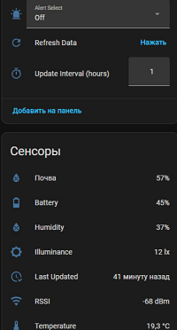

# 🌱 MCLH-09 Plant Sensor для Home Assistant

Кастомная интеграция для Home Assistant, которая позволяет подключаться к Bluetooth-датчикам растений **MCLH-09** напрямую, без использования промежуточных MQTT-шлюзов и пр. Вся работа идёт через штатный Bluetooth-адаптер вашего сервера или через **Bluetooth Proxy**.

## ✨ Возможности

*   **Прямое подключение:** Работает через штатный Bluetooth-адаптер Home Assistant (hci0) или через **ESP32 Bluetooth Proxy** (рекомендуется для больших помещений).
*   **Автоматическое обнаружение:** Home Assistant сам найдёт датчики в радиусе действия и предложит их добавить (с указанием MAC-адреса).
*   **Сенсоры:** Температура, Влажность воздуха, Влажность почвы, Освещённость, Заряд батареи.
*   **RSSI (Уровень сигнала):** Отображает качество связи с датчиком в dBm.
*   **Last Updated (Время обновления):** Показывает, когда датчик последний раз выходил на связь.
*   **Восстановление данных:** После перезагрузки Home Assistant сенсоры показывают последние известные значения, пока не придут новые.
*   **Управление:** Кнопка ручного обновления данных (`Refresh Data`) и настройка интервала опроса прямо из интерфейса.
*   **Калибровка:** Выпадающий список команд для калибровки температуры, влажности почвы и сброса на заводские настройки.
*   **Стабильность:** Поддержка нескольких датчиков с последовательным опросом, что снижает нагрузку на Bluetooth-адаптер.

---

## 📥 Установка

### Способ 1: Через HACS (Рекомендуется)

1.  Убедитесь, что у вас установлен [HACS](https://hacs.xyz/).
2.  В Home Assistant перейдите в **HACS → Интеграции**.
3.  Нажмите на три точки в правом верхнем углу и выберите **«Пользовательские репозитории»** (Custom repositories).
4.  Вставьте ссылку на этот репозиторий: `https://github.com/parus2024/mclh-09`
5.  В поле «Категория» выберите **Интеграция** (Integration) и нажмите **Добавить**.
6.  Найдите `MCLH-09 Plant Sensor` в поиске HACS и нажмите **Скачать**.
7.  **Перезагрузите Home Assistant**.

### Способ 2: Вручную

1.  Скачайте этот репозиторий (кнопка `Code` → `Download ZIP`) или склонируйте его.
2.  Скопируйте папку `custom_components/mclh09` в директорию `config/custom_components/` вашего Home Assistant.
3.  **Перезагрузите Home Assistant**.

---

## 🚀 Настройка

1.  После перезагрузки Home Assistant автоматически обнаружит датчики MCLH-09 в радиусе действия.
2.  Перейдите в **Настройки → Устройства и службы**. В разделе «Обнаружено» появятся новые устройства с указанием их MAC-адресов (например, `MCLH-09 Plant Sensor (00:1B:DC:4B:12:A6)`).
3.  Нажмите **«Добавить»** для каждого датчика.

---

## 🛠️ Использование

В карточке каждого устройства появятся следующие элементы управления:

*   **Сенсоры:** Отображают текущие показания. Данные обновляются автоматически.
*   **Update Interval (min):** Позволяет изменить интервал автоматического опроса (по умолчанию 5 минут). Рекомендуется не ставить меньше 1 минуты для экономии батареи.
*   **Refresh Data:** Кнопка для принудительного опроса датчика в любой момент.
*   **Alert Select:** Выпадающий список для отправки команд калибровки.

### 📋 Команды калибровки (Alert Select)

| Команда | Действие |
| :--- | :--- |
| **Off** | Сброс свечения. |
| **Calibrate Temp (Red)** | Калибровка температуры при +24.6 °C. |
| **Calibrate Soil/Lux (Green)** | Калибровка 0% влажности почвы и 798 lx. *Электроды должны быть сухими и в воздухе.* |
| **Factory Reset (Red+Green)** | Сброс всех значений на заводские. |
| **Soil to 0% (Green)** | Принудительно устанавливает 0% влажности (деструктивно). |
| **Soil to 100% (Green)** | Принудительно устанавливает 100% влажности (деструктивно). |

> ⚠️ **Внимание:** После выбора любой команды, кроме `Off`, список автоматически вернётся в положение `Off`, а показания сенсоров обновятся сразу же.

---

## 📡 Расширение сети (Bluetooth Proxy)

Если ваш сервер Home Assistant находится далеко от растений, или сигнал Bluetooth не пробивает стены, вы можете использовать **Bluetooth-удлинитель**, например **Bluetooth-прокси на базе ESP32 с ESPHome**. Это устройство будет работать как «удлинитель» Bluetooth, передавая данные в Home Assistant по Wi-Fi.

Наша интеграция `mclh09` автоматически увидит датчики, даже если они подключены через прокси. Home Assistant не различает, откуда пришёл Bluetooth-сигнал (с самого сервера или через прокси).

---

## ❓ Частые вопросы (FAQ)

**Датчик не обнаруживается.**
Убедитесь, что Bluetooth-адаптер Home Assistant находится в зоне действия датчика. Встроенные адаптеры (hci0) иногда имеют лимит подключений (обычно до 3 устройств). Если у вас много BLE-устройств, используйте Bluetooth-прокси на ESP32.

**Показания температуры или влажности выглядят странно.**
Датчик имеет встроенные калибровочные таблицы. Если вы обнаружили, что показания неточны, вы можете откалибровать датчик с помощью команд в `Alert Select` (например, `Calibrate Temp`).

## 📊 Скриншоты и Видео

- [скриншот](images/screenshot.png)
- [дашборд](images/dashboard.png)
- [Видео YOUTUBE](https://youtu.be/hM67obejF2Q)
- [Видео RUTUBE](https://rutube.ru/video/b3d5c235215f47a60e9a96bd8c93612f/)

## ⚠️ Известные ограничения

*   Интеграция разработана и протестирована на Home Assistant версии **2026.9.0** и выше.
*   Для работы требуется исправный Bluetooth-адаптер, поддерживающий BLE (Bluetooth Low Energy).
*   Датчик не имеет кнопки сопряжения и не уходит в сон, однако при частых опросах (менее 1 минуты) батарея может разряжаться быстрее.

##  Дополнительные источники информации

Телеграм канал https://t.me/parus_smart
Макс канал https://max.ru/channel_parus_smart

## 📄 Лицензия

Этот проект распространяется под лицензией MIT.
*Создано с ❤️ ParusSmartHome. Версия: 1.1.1 от 13.11.2026*
